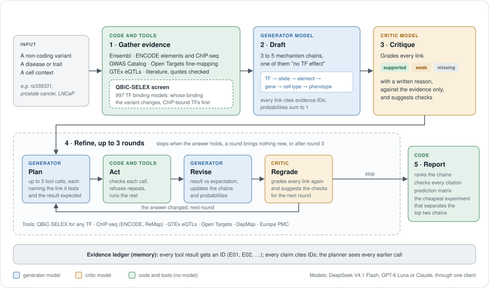
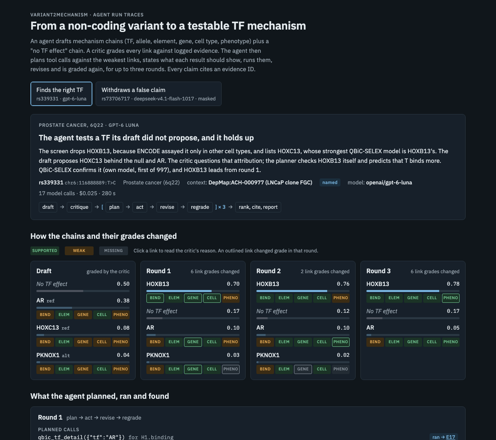

# variant2mechanism

**An agent that explains a non-coding variant.** Give it a variant and a disease, and it proposes ranked, testable
mechanisms: which transcription factor (TF) is involved, which allele binds it more, and through which element, gene,
cell type and phenotype. Every claim cites logged evidence, and a separate critic model grades each link before the
agent commits. It is built around [QBiC-SELEX](https://github.com/sean00002/QBiC-SELEX), a model of how a single-base
change alters TF binding.



## How it works

1. **Gather.** Code collects evidence about the variant from Ensembl, ENCODE, the GWAS Catalog, Open Targets, GTEx and
   Europe PMC, and runs the QBiC-SELEX screen. Each result enters an evidence ledger with an ID (E01, E02, ...).
2. **Draft.** The generator model writes 3 to 5 mechanism chains, one of them "no TF effect", with probabilities that
   sum to 1. Each chain has five links (binding, element, gene, cell type, phenotype), and each link cites evidence IDs.
3. **Critique.** The critic model grades every link as supported, weak or missing, with a reason.
4. **Refine, up to 3 rounds.** The agent plans up to 3 tool calls aimed at the weakest links, writing down for each the
   result it expects. Code checks the calls, refuses repeats and runs them. The agent revises, saying whether each result
   matched its expectation, and the critic grades again. The loop stops when the answer holds, when a round brings
   nothing new, or after round 3.
5. **Report.** Code ranks the chains, checks that every citation exists and passed its checks, and proposes the
   cheapest experiment that would separate the top two chains.

## Two runs

[](https://htmlpreview.github.io/?https://github.com/sean00002/variant2mechanism/blob/main/demo/run_viewer.html)

The [run viewer](https://htmlpreview.github.io/?https://github.com/sean00002/variant2mechanism/blob/main/demo/run_viewer.html)
(also `demo/run_viewer.html`) shows two runs round by round:

- **It finds the right TF (rs339331, prostate cancer).** The draft does not propose HOXB13. The critic questions the
  draft's TF; the agent checks HOXB13 itself, predicts that the T allele binds more, and QBiC-SELEX confirms it
  (first of 997 models). HOXB13 leads from round 1.
- **It withdraws a false claim (rs73706717, rsID hidden from the model).** The variant shares a TCF7L2 ChIP-seq peak
  with the famous rs6983267 next door, and the draft ranks TCF7L2 first. The agent predicts three results (no eQTL, no
  second TF peak, only a weak TCF7L2 site), all three come back as predicted, and "no TF effect" moves to first.

## Quick start

```bash
uv sync
```

```bash
uv run pytest -q
```

To run the agent, set `OPENROUTER_API_KEY` in your environment (it is never printed or logged), then:

```bash
uv run v2m run --case rs339331 --config full --profile luna
```

- **Configurations:** `single` (one model call, no tools), `no_qbic` (the full loop without QBiC-SELEX) and `full`.
  Add `--masked` to hide the rsID from the model.
- **Models:** DeepSeek V4.1 Flash by default; `--profile luna` or `--profile claude` switches all three roles.
- **QBiC-SELEX:** statistics for the 15 gold-set variants are cached in `cache/qbic.sqlite`, so they run without
  QBiC-SELEX. A new variant needs a QBiC-SELEX run first (`scripts/prefetch.py`): the default backend runs `qbic-selex`
  on this machine (set the paths under `local` in `config.yaml`); the backup runs it on a Slurm cluster over SSH (set
  `qbic.backend: slurm` and the `cluster` and `slurm` sections).

## Repository

| Path | What it holds |
|---|---|
| `src/variant2mechanism/agent/` | The loop: stages, prompts, schemas, evidence ledger, model client, report |
| `src/variant2mechanism/context/` | Evidence tools (Ensembl, ENCODE, ReMap, GWAS Catalog, Open Targets, GTEx, DepMap, Europe PMC) |
| `src/variant2mechanism/qbic/` | QBiC-SELEX: TF names and coverage, the screen, the cache, local and cluster backends |
| `src/variant2mechanism/evaluation/` | Gold set, runner, metrics |
| `data/gold_set.csv` | The 15 evaluation cases |
| `eval/` | Write-ups of every comparison |
| `runs/` | The reports of every evaluation run |
| `demo/` | The run viewer and its two reports |
| `scripts/` | Comparisons, the viewer generator, fixture recording |
