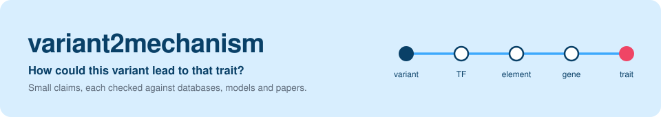
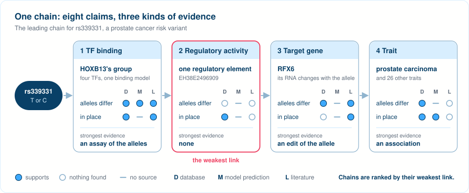
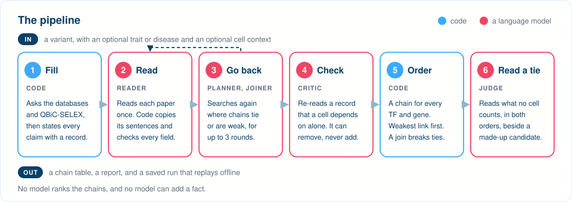
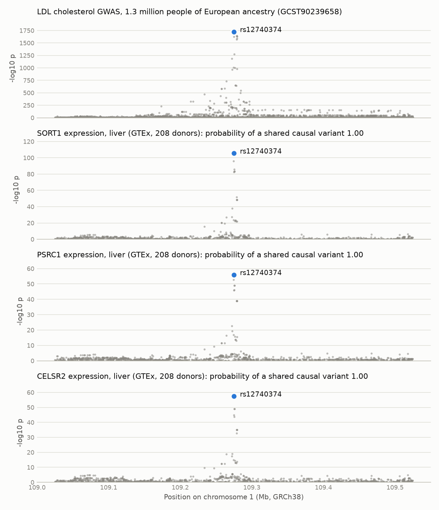

<p align="center">
  
</p>

**variant2mechanism (v2m) is an agentic workflow that works out how a non-coding variant could lead to a trait, a
disease or a cancer.** It builds the mechanism as a chain of small claims, from the variant through the molecular
steps in between to the trait. It backs each claim with three kinds of evidence: data in public databases, model
predictions, and experiments read from the literature.

- **Give it a variant alone,** and it looks for the chains that lead from that variant to any trait.
- **Give it a variant and a trait or disease,** and it works on the steps between the two.

Code gathers the evidence and ranks the chains. Language models read the papers and check the records, and none of
them can add a fact that code cannot find in a source.

> [!NOTE]
> **This is a prototype (version 9).** It is built around one model,
> [QBiC-SELEX](https://github.com/sean00002/QBiC-SELEX), which predicts how a variant changes transcription factor
> (TF) binding. So today every chain runs through TF binding. Later versions will add predictions from other
> deep-learning models, such as AlphaGenome and ChromBPNet-style models, and statistical-genetics models, and with
> them other routes from a variant to a trait.

[The aim and the prototype](#the-aim-and-the-prototype) · [What comes out](#what-comes-out) ·
[How it works](#how-it-works) · [Results](#results) · [Try it](#try-it) · [Full report](docs/report.md)

## The aim and the prototype

| The aim | In this prototype |
|---|---|
| Any route from a variant to a trait, with whatever molecular steps lie between | One route with four steps: TF binding, regulatory activity, target gene, trait |
| Three kinds of evidence for every claim | In place: database records, model predictions and experiments read from papers |
| Start from a variant alone, or from a variant and a trait | Both run. With a trait given, the trait step is limited to it. The scored test used the variant alone |
| Predictions from many models | One so far: QBiC-SELEX, for TF binding |
| Agents that go back for the evidence a chain is missing | Not yet. Code looks everything up once, and the models read and check |

## What comes out

A chain names a TF (or a group of TFs that share a binding model), the regulatory element the variant lies in, a
target gene and a trait. It has four steps, and each step is two claims: the two alleles differ, and the parts are
in place. Each claim has three cells, one for each kind of evidence.

<p align="center">
  
</p>

<details>
<summary>The same chain as a table, with the number of records in each cell</summary>

| Step | Claim | What it names | Database | Model prediction | Literature |
|---|---|---|---|---|---|
| TF binding | The alleles differ | HOXA13, HOXB13, HOXC13, HOXD13 (one binding model) | supports (1, assay) | supports (1, prediction) | supports (4, assay) |
| TF binding | The parts are in place | the same group | supports (33, occupancy) | no source | supports (8, occupancy) |
| Regulatory activity | The alleles differ | the element EH38E2496909 | nothing found | no source | nothing found |
| Regulatory activity | The parts are in place | the element EH38E2496909 | supports (1, annotation) | no source | nothing found |
| Target gene | The alleles differ | RFX6 | supports (6, association) | no source | supports (3, edit) |
| Target gene | The parts are in place | RFX6 | nothing found | no source | supports (4, edit) |
| Trait | The alleles differ | prostate carcinoma and 26 other traits | supports (88, association) | no source | nothing found |
| Trait | The parts are in place | RFX6 and prostate carcinoma, and 25 other pairs | supports (8, association) | supports (74, prediction) | nothing found |

"Supports (4, assay)" means four records support the claim and the strongest is an assay that compares the alleles.
"Nothing found" means a source was asked and held nothing. "No source" means the workflow has no source of that kind
for that claim.

</details>

- **Every mark is a record that can be checked.** The database record under the first claim is an allele-specific
  binding call: ChIP-seq reads of HOXB13 favour the T allele (ADASTRA, FDR 0.0004). One of the literature records
  quotes its article, which found "greater binding to the T variant than the C allele" (PMID 26398868).
- **Gaps stay visible.** No source the workflow reads has compared the two alleles' regulatory activity at this
  variant. That claim says "nothing found", and the chain is reported as a partial mechanism
  ([saved run](demo/tables/rs339331/answer.md)).

## How it is designed

1. **One variant, the whole route.** Every chain has the same eight claims and every claim the same three cells, so
   a table can be checked for gaps without knowing the right answer.
2. **Two kinds of claim.** Only a record that compares this variant's two alleles can support "the alleles differ".
   A knock-down of the TF, a deletion of the element or a result at a neighbouring variant shows that the parts are
   in place, and counts only there.
3. **A model's memory is never evidence.** A model reads an article and points to sentences. Code copies those
   sentences from the article's text and files a record only when every field checks out. The reason is measured:
   asked with no tools and no evidence, the model names the published TF at all nine test cases
   ([`docs/limitations.md`](docs/limitations.md)).
4. **Code ranks the chains.** Chains are ordered by their weakest link, and a link is as strong as the kind of
   evidence under it: an edit, an assay that compares the alleles, an association, a prediction, or nothing. Effect
   sizes and the number of records never enter. Chains that are equal tie, and the report shows the tie.
5. **No model can add a fact.** The reader's records must pass code's checks. The critic can take a record out or
   repair its quotation. The judge changes no cell and no rank. Each role is tested with controls that need no right
   answer.

## How it works

<p align="center">
  
</p>

| Step | Who | What happens |
|---|---|---|
| 1. Fill | code | Collects what the databases hold at the variant and the QBiC-SELEX predictions, states a claim for everything a record can count for, and links each record to its claims |
| 2. Read | first model | Reads each article that names the variant, once, without being told what the run hopes to find. Code copies the sentences it points to and files what passes its checks |
| 3. Check | second model | Re-reads each record that a cell depends on alone, against the article's text and the claim. It can take the record out or point to the sentences that state the result |
| 4. Order | code | Builds a chain for every pair of TF and gene and orders the chains by their weakest link |
| 5. Read a tie | second model | Only when chains tie for first: reads the experiments that no cell counts, twice, in opposite orders, with a made-up candidate in each. Its answer is written under the tie |

- **Models.** The reader runs on GPT-6 Luna through OpenRouter. The critic and the judge run on Claude Sonnet 5.5
  through the Anthropic API. The second model comes from another provider on purpose: two readings by one model
  share its blind spots.
- **Cost.** The 15 test variants took 126 model calls, about 43 cents at list prices, or 3 cents a variant.
- **Replay.** A run is saved with its tool results and model replies, and `v2m v9 replay` re-runs it offline from
  those. The response caches are not in the repository.

### How claims become a chain

- **Claims.** Every statement is a claim between two things: the variant, a TF, an element, a gene, a trait. The
  claims and the records under them are kept in one graph. A record is linked to a claim only if it passes checks on
  the variant, the names, the direction and the context.
- **Candidates.** Claims are grouped by what they name. TFs that share a QBiC-SELEX model form one candidate, so a
  prediction for the group and an assay of one member read as one.
- **Chains.** A chain takes one TF candidate and one gene candidate, and there is a chain for every pair. It adds
  the claims about the site's regulatory activity, the claims that link that gene to a trait, and the variant's own
  trait claims. A claim joins a chain whichever source or model stated it.
- **Order.** Each claim gets the strongest kind of evidence under it. Chains are compared weakest link first, then
  the next weakest, and so on. Two yes-or-no facts then break ties: a strong QBiC-SELEX prediction with a ChIP-seq
  peak over the variant, and records that show the TF in place. Chains that are still equal share a rank.

The order guarantees that a chain never ranks above one that is at least as strong on every link. It needs no
weights, and it drops no TF or gene for lack of data. It does not show that one link causes the next: a chain pairs
every TF with every gene, and no claim says that this TF regulates this gene.

The table's full definition, its rules and the source of every cell are in
[`docs/chain-table.md`](docs/chain-table.md).

## The methods behind each step

| Step | Records the pipeline reads | Prediction today | Planned |
|---|---|---|---|
| TF binding | Allele-specific binding from ChIP-seq (ADASTRA), ChIP-seq peaks (ReMap), binding assays in papers | QBiC-SELEX | Other models of TF binding |
| Regulatory activity | Registries of regulatory elements (ENCODE, Ensembl), reporter assays and edits in papers | None | AlphaGenome and ChromBPNet-style models |
| Target gene | eQTLs (GTEx), credible sets and colocalisations (Open Targets), edits in papers | None | Expression predictions; fine-mapping and colocalisation |
| Trait | GWAS associations and credible sets, gene and disease records (Open Targets), perturbations in papers | Published locus-to-gene scores | Fine-mapping and colocalisation |

**QBiC-SELEX.** QBiC-SELEX predicts from SELEX data how a single-base change alters the binding of a TF. Version
1.0.0 has 997 models, in 631 groups of TFs that share a model. For a variant, v2m keeps every group with a model
past a Bonferroni gate. The gate alone passes about a third of the groups at a typical variant (22% to 68% over the
15 test variants), so the size of a prediction is read against a background: the same statistic over 21.8 million
unlabelled variants. A change in the top 10% for its own group, with a ChIP-seq peak over the variant, is labelled a
strong prediction. The label only breaks ties. A TF with no model, or with a small predicted change, is never
dropped.

**Fine-mapping and colocalisation.** [`src/variant2mechanism/statgen`](src/variant2mechanism/statgen) works from
published summary statistics alone, with no language model. It computes each variant's probability of being the
causal one, credible sets, a model for several signals at one locus, and whether a trait and a gene's expression
share a causal variant. It is not yet a source of the chain table, which reads published credible sets and
colocalisations. Its worked example is the locus of rs12740374: three genes colocalise with LDL cholesterol equally
there, so the statistics alone cannot name the gene ([`docs/statgen.md`](docs/statgen.md)).

<p align="center">
  
</p>

## Results

The test set is 15 variants: 9 published TF mechanisms and 6 controls (3 random variants and 3 near misses beside a
published one), each run from the variant alone. The pipeline was frozen by the hash of every file it executes, the
scoring rule was written before any table was scored, and the tables were scored once.

A case's answer is the set of chains tied for first. "Named" counts a case when one of those chains names the
published answer. "By share" is what picking one candidate from each tie at random would get.

| Component | Named | By share |
|---|---|---|
| TF, as its group | 7 of 8 | 3.95 of 8 |
| Target gene | 6 of 9 | 4.58 of 9 |
| TF group and gene in one chain | 4 of 9 | 2.25 of 9 |
| Trait | 7 of 9 | 7.00 of 9 |

- **Two clean answers.** rs339331 and rs2168101 each have one leading chain, and it names the published TF group,
  gene and trait.
- **Right group, rarely alone.** The published TF's group is among the leaders in 7 of 8 cases, usually beside
  others: ties hold 2 to 12 chains.
- **Never the single TF.** TFs that share a model are one candidate, so the published TF itself is named in 0 of 9.
- **The judge.** With its answers applied, the share rises to 4.86 for the TF group and 3.17 for both in one chain.
  All of that gain is at rs12740374, a case used while an earlier version was built.
- **Controls.** The first chain has support for 5.9 of its 8 claims in the published cases, 4.7 in the near misses
  and 1.7 in the random variants. It holds a measured claim that the alleles differ in 7 of 9 published cases and
  1 of 6 controls.

Where it missed, and why:

- **TERT promoter, two cases.** The literature search uses the rsID, and the papers name these mutations by position.
  No database the pipeline reads holds a somatic mutation, so no chain names a gene or a trait.
- **MYC at rs6983267.** No record says the alleles differ in MYC. One article reports allele-specific expression of
  CCAT2, so the leading chains name CCAT2.
- **AP-2α at rs642961.** The right experiment was filed under the article's name for the protein, which nothing maps
  to the gene symbol TFAP2A.
- **ARID5B at rs1421085.** No QBiC-SELEX model covers it and no filed record names it.

What these numbers are not: a blind test. The published answers were known while the pipeline was designed, the
answer key is still unreviewed, and nine cases support no statistical claim. Every number, case by case, is in
[`eval/fill_score_20261123.md`](eval/fill_score_20261123.md).

### What keeps the model roles in check

| Role | Its limit | What its check found |
|---|---|---|
| Reader | A record needs sentences that code finds in the article, and fields that agree with them | On the 15 variants it returned 262 experiments from 87 articles. Code filed 166 and linked 60 to a claim |
| Critic | It can only take a record out or repair its quotation | On 44 audited records, 5 of them wrong, it took out 4, repaired the fifth and took out none of the other 39. It rejected all 25 claims that the text never makes |
| Judge | It changes no cell and no rank, and an answer is kept only when both orders agree | It turned down the made-up candidate in 14 of 14 readings. On the 15 variants it pointed to one TF group |

## Runs to look at

Each folder in [`demo/tables/`](demo/tables/) is the public copy of one saved run: `answer.md` (the ranked chains
and the outcome), `table.md` (the eight claims) and the saved graph they were built from.

- **[rs339331](demo/tables/rs339331/answer.md): one leading chain.** The HOXB13 group and RFX6, with measured
  evidence for TF binding and for the gene.
- **[rs12740374](demo/tables/rs12740374/answer.md): a tie that the judge reads.** Twelve TF groups tie on a
  prediction alone. The judge points to the C/EBP group from two experiments that no cell could count.
- **[TERT C228T](demo/tables/tert_c228t/answer.md): a miss.** A prediction, ChIP-seq peaks and the element's
  annotation are all it finds: three of eight claims have support, and no gene is named.
- **[rs7001688](demo/tables/rs7001688/answer.md): a random control.** 316 chains tie, and one claim of eight has
  support, a prediction.

## Try it

Read the saved runs on this page, or rebuild their tables from the saved graphs. Neither needs a key or the network:

```bash
uv sync
uv run python scripts/v9_chain_table.py --runs demo/tables --out /tmp/v2m_tables
```

Recompute the score. Scoring reads two public reference tables that are not in the repository, the HGNC gene names
and the human TF catalogue:

```bash
mkdir -p data/reference/hgnc data/reference/tf_families
curl -L -o data/reference/hgnc/hgnc_complete_set.txt https://storage.googleapis.com/public-download-files/hgnc/tsv/tsv/hgnc_complete_set.txt
curl -L -o data/reference/tf_families/DatabaseExtract_v_1.01.csv https://humantfs.ccbr.utoronto.ca/download/v_1.01/DatabaseExtract_v_1.01.csv
uv run python scripts/v9_table_score.py --runs demo/tables --out /tmp/v2m_score
```

Render a run's whole report, with every quotation:

```bash
mkdir -p /tmp/v2m_run && gunzip -c demo/tables/rs339331/graph.json.gz > /tmp/v2m_run/graph.json
uv run v2m v9 report --run /tmp/v2m_run
```

Run a variant, alone or with a trait. Without `--read` no model is called:

```bash
uv run v2m v9 fill --variant chr6:116888889:T>C --origin germline --read --critic --judge --out runs/my_run
uv run v2m v9 fill --variant chr6:116888889:T>C --disease "prostate cancer" --read --critic --judge --out runs/my_run_2
```

- **Keys.** `OPENROUTER_API_KEY` for the reader and `V2M_ANTHROPIC_API_KEY` for the critic and the judge. Neither is
  printed or logged.
- **Data.** The reference files named under `data:` in [`config.yaml`](config.yaml).
- **QBiC-SELEX.** Predictions for the 15 test variants are cached in `cache/qbic.sqlite`. A new variant needs a
  QBiC-SELEX run first (`scripts/prefetch.py`).
- **Tests.** `uv run pytest -q`. From a fresh clone, the tests that need the local data folder are skipped.

## Limits

- **One route.** Every chain runs through TF binding, with four fixed steps. Other routes from a variant to a trait
  are not represented yet.
- **One pass.** Code looks everything up once. Nothing goes back for the evidence a chain is missing.
- **It finds what its sources index.** A variant that papers name by position, or a protein named by an alias, is
  missed. Somatic promoter mutations are the clearest gap.
- **A gene is named only if a source names it.** A variant inside a promoter does not name that promoter's gene.
- **Ties are common.** Many variants end with several chains that hold the same kinds of evidence.
- **The order of evidence is a choice.** Edit, assay, association and prediction are ranked by kind, not calibrated
  against known variants.
- **The trait step is broad.** With no trait given, a chain lists every trait a source ties to the variant.
- **The test is small and not blind.** Fifteen well-known variants, used throughout development.

## What comes next

- **More models.** Predictions of regulatory activity and expression from AlphaGenome and ChromBPNet-style models,
  beside QBiC-SELEX for TF binding.
- **Statistical-genetics models as sources.** Fine-mapping and colocalisation, which the repository already computes.
- **More routes.** Chains whose steps are not fixed in advance, so that a mechanism need not run through TF binding.
- **Going back for evidence.** When a chain has a gap, look for what would fill it, then build the chains again.
- **A wider test.** Variants outside the 15, chosen before any run.

## Earlier versions

Version 8 is still in the repository as the reference (`src/variant2mechanism/v8/`). Its evaluation is why version 9
is built the way it is: the agent named the published TF first in 6 of 27 runs and code alone in 2 of 9 cases, while
the model, asked with no tools, named it in 9 of 9. The cases are well known, so a correct name shows recall, not
reasoning. Results are in [`eval/v8_results.md`](eval/v8_results.md), limits in
[`docs/limitations.md`](docs/limitations.md) and three saved runs in [`demo/v8/`](demo/v8/).

## Repository

| Path | What it holds |
|---|---|
| `src/variant2mechanism/v9/` | The pipeline: the claim graph, the fill, the reader, the critic, the judge, the chain table and the report |
| `src/variant2mechanism/qbic/` | QBiC-SELEX: models, groups, the cache and the background of 21.8 million variants |
| `src/variant2mechanism/statgen/` | Fine-mapping and colocalisation from summary statistics |
| `src/variant2mechanism/v8/`, `agent/`, `context/` | Version 8, the model client and the evidence tools |
| `scripts/` | Suites, checks of each role, the freeze, the scorer and the public export |
| `demo/tables/` | Public copies of the 15 scored runs |
| `eval/` | The freeze, the answer key, the scores, and the results of earlier versions |
| `docs/` | The report, the chain table's definition, the statistical module and the limits of version 8 |
| `data/gold_set.csv` | The 15 test cases |
