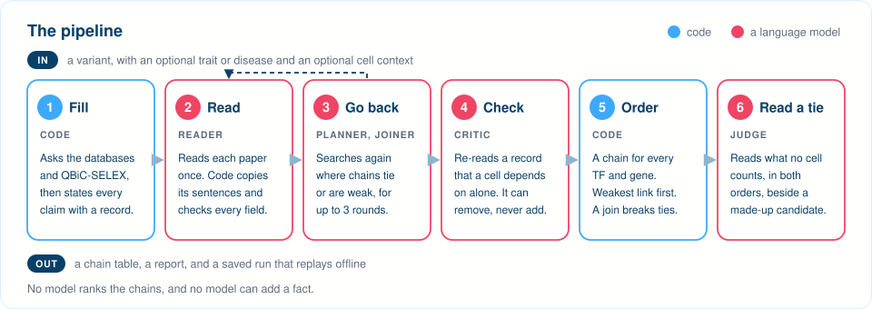

# variant2mechanism, version 9: project report

23 November 2026, with additions to 25 November

## Summary

- **What it is for.** To work out how a non-coding variant could lead to a trait, a disease or a cancer. The answer
  is a chain of small claims from the variant to the trait, each backed by data in databases, model predictions and
  experiments read from the literature. A run starts from a variant alone, or from a variant and a trait.
- **What this version is.** A prototype built around one model, QBiC-SELEX, which predicts how a variant changes
  transcription factor (TF) binding. So every chain runs through TF binding and has four fixed steps. Other models
  and other routes are planned (see "What comes next").
- **What it does.** For one variant, the pipeline builds that route as eight small claims and shows, for each
  claim, what a database, a model prediction and the literature say.
- **Who does what.** Code fills the table and ranks the chains. Three language-model roles read papers, check
  records and read ties. None of them can add a fact that code cannot find in a source.
- **How it was tested.** The pipeline was frozen and scored once on 15 variants: 9 published mechanisms and 6
  controls.
- **What it found.** The published TF's group is among the leading chains in 7 of 8 cases, usually tied with
  others. Two cases have one leading chain, and both are right. The published TF itself is never named.
- **Where it fails.** It finds only what its sources index. The two somatic promoter mutations in the test set get
  no gene and no trait.
- **Since the scoring.** Five more sources, a rule for a mutation's own name, a record that joins a TF to a gene,
  and a loop that goes back for evidence, with two more model roles. None of these is scored, and the loop has not
  yet been run with a model (see "Since the scored version").

## The question

Given a non-coding variant, what is the route by which it could change a trait, and how good is the evidence for
each step of that route?

The answer is a table, not a paragraph. A chain is one route: a transcription factor (TF), the regulatory element
the variant lies in, a target gene and a trait. Each chain has four steps and each step two claims.

| Step | The alleles differ | The parts are in place |
|---|---|---|
| 1. TF binding | The two alleles differ in binding the TF | The TF is present where it would act |
| 2. Regulatory activity | The two alleles differ in the regulatory activity of the site | The variant lies in a regulatory element |
| 3. Target gene | The two alleles differ in the gene's RNA or protein | The element regulates the gene |
| 4. Trait | The two alleles differ in the trait | The gene bears on the trait |

Each claim has three cells, one per kind of record: a database record, a model prediction, and an experiment read
from an article. A cell says "supports", "disagrees", "nothing found", "not checked" or "no source". The full
definition is in [`chain-table.md`](chain-table.md).

## Design rules

1. **A fixed table.** Every chain has the same eight claims and every claim the same three cells. A checker tests a
   table against the rules without knowing the right answer, so the same check works for a variant nobody has
   studied.
2. **Two kinds of claim.** The left column is about this variant's two alleles. Only a record that compares them can
   support it. A knock-down of the TF, a deletion of the element, a perturbation of the gene or a result at a
   neighbouring variant can support only the right column.
3. **A model's memory is never evidence.** Version 8 showed why. Asked with no tools and no evidence, the model
   named the published TF at all nine test cases. A correct name therefore shows recall. In version 9 a model may
   read an article and point to sentences, and code decides what the sentences are evidence for.
4. **Kinds of evidence, not amounts.** A claim is as strong as the strongest kind of record under it: an edit, an
   assay that compares the alleles, an association, a prediction, or nothing. Effect sizes, read counts, expression
   levels and the number of records do not enter the order. A TF that was never assayed is not a TF that is absent,
   so a missing record removes nothing.
5. **No model can add a fact.** Each model role has a narrow job with a limit that code enforces.

## The pipeline



The figure shows the pipeline as it is now. Step 3, going back for evidence, was added after the scoring and is
described under "Since the scored version". The stages below are the ones that were frozen and scored.

| Stage | Who | What it is given | What it returns |
|---|---|---|---|
| Fill | code | The variant | Every claim a database record or a QBiC-SELEX prediction can count for, with its records |
| Find and choose articles | code | The variant's rsIDs | Up to 20 articles that name the variant; reviews are left out |
| Read | first model | One article and the variant, and nothing about what the run hopes to find | The experiments the article reports, each pointing to at most four sentences |
| File and link | code | The model's pointers | A record for each experiment whose sentences and fields check out, linked to the claims it bears on |
| Check | second model | A record that a cell depends on alone, its paragraph, and the claims it counts for | For each claim: shown, not shown or cannot tell |
| Order | code | The table | Chains ranked by their weakest link, with ties |
| Read a tie | second model | The experiments that no cell counts, for the tied TFs and genes | For each: tied to the site, not tied or cannot tell |

**The reader points and code quotes.** Each passage is shown with numbered sentences. The model names a run of
sentences and code copies it, so a quotation is the article's own text by construction. A reply that breaks a limit
is sent back once. What still breaks it is refused.

**The critic reads only what can change a cell.** Taking the one record out of a cell changes the cell. Taking out
one of several changes nothing. So only records that stand alone are sent. The critic sees the article's text and
the claim, and nothing of the reader's reading.

**The judge reads what no cell may count.** Some experiments test no single claim. A TF is removed and the
difference between the alleles goes away: that names a TF, yet it does not compare the alleles' binding. The judge
reads such experiments for the chains tied for first, and its answer is written under the tie. It changes no cell
and no rank.

**Chains.** A chain takes one TF candidate and one gene candidate, and there is a chain for every pair. TFs that
share a QBiC-SELEX model are one candidate. Chains are compared weakest link first, then the next weakest. Two
yes-or-no facts break ties: a strong QBiC-SELEX prediction with a ChIP-seq peak over the variant, and records that
show the TF in place. A chain never ranks above one that is at least as strong on every link.

**Numbers and gaps.** Under the table the report lists what each source returned for each cell, copied by code
from the saved records and never ranked on. For each claim that no measurement supports it names the experiment or
the model run that would fill it. Both were added after the scoring and are display only.

**Models and cost.** The reader runs on GPT-6 Luna and the critic and judge on Claude Sonnet 5.5, a model from
another provider. The 15 test variants took 126 model calls: 98 by the reader, 20 by the critic and 8 by the judge.
At list prices that is about 43 cents, or 3 cents a variant.

## Testing the roles without an answer key

The 15 test variants have published answers, and the pipeline's rules were not to be tuned to them. So each role was
tested with controls that need no answer key.

**The reader.** Code's checks are the test. On the 15 variants the searches found 134 articles. The model read 87 of
them and returned 262 experiments. Code filed 166 as records and linked 60 of them to a claim of a table. The rest
are on file and count for nothing. An audit of one earlier run found 5 wrong among 44 counted records. The reader's
rules were tightened after it, and the 44 became the critic's test.

**The critic.**

| Check | What was read | What the critic did |
|---|---|---|
| Decoys, on variants outside the test set | 34 real claims and 25 claims whose TF or gene the paragraph never names | Rejected all 25 decoys and kept all 34 real claims. For 6 it pointed to further sentences that state the result |
| The audited records | 44 counted records, 5 of them wrong | Took out 4 of the 5 and none of the other 39. It kept the fifth and quoted the later sentences that do support it |
| The 15 test variants | 60 counted records, 20 of them alone behind a claim | Read the 20: 29 of 30 claims shown, one "cannot tell", none taken out. No cell changed |

With today's reader the critic changes nothing in the 15 tables. Its value there is a second reading on file beside
each record that carries a cell alone. On records from the earlier reader it removes the known errors.

**The judge.**

| Set | Ties for first | With experiments to read | Points to | Made-up candidate turned down |
|---|---|---|---|---|
| 8 variants outside the test set | 4 | 3 | PRRX1 at rs4684847, KITLG at rs12821256 | 6 of 6 readings |
| The 15 test variants, run once | 10 | 4 | the C/EBP group at rs12740374 | 8 of 8 readings |

Every question to the judge carries one made-up candidate, a TF or gene that no paragraph names, and is asked twice
with the candidates in opposite orders. An answer is kept only when both readings give it. A reading that accepts
the made-up candidate invalidates the whole tie.

Development found four faults, and each changed the protocol before it was frozen:

- **It trusted code's list.** The judge accepted a renamed candidate while noting that the article names another
  factor. It is now told to find the candidate in the paragraph itself.
- **It favoured the first candidate.** The candidate listed first was twice given an answer its records did not
  bear out. That is why each question is asked in both orders, and why the made-up candidate exists: it gives a tie
  with one candidate a second position to be read in.
- **Its answer contradicted its reason.** The reply now gives the reason before the answer.
- **One bad pointer lost a whole reading.** A pointer that code cannot copy now costs only the pointer.

## The frozen test

**The freeze.** `eval/fill_freeze_20261123.json` holds the hash of every file a run executes (151 files) and of the
15 tables. `scripts/v9_freeze.py check` lists anything that has changed since, and the scorer refuses to run if
something has.

**The rule, written before any table was scored.** A case's answer is the set of chains tied for first. Names are
matched by the answer key's own rules. "Named" counts a case when a first-ranked chain names the published answer.
"By share" is the matching candidates over the candidates in the tie, summed over cases: what picking one candidate
from each tie at random would get. Both are given again with the judge's answers applied. Direction and context are
not scored, and controls get no score. The rule is the docstring of `scripts/v9_table_score.py`.

| Component | Cases it applies to | Named | By share | By share, with the judge |
|---|---|---|---|---|
| TF, as the member | 9 | 0 | 0.00 | 0.00 |
| TF, as its group | 8 | 7 | 3.95 | 4.86 |
| TF, as its family | 8 | 7 | 4.28 | 4.86 |
| Target gene | 9 | 6 | 4.58 | 4.58 |
| TF group and gene in one chain | 9 | 4 | 2.25 | 3.17 |
| Trait | 9 | 7 | 7.00 | 7.00 |

Two of the nine cases, rs12740374 and TERT C228T, were used while an earlier version was built. Without them the
judge changes no number:

| Component | Cases it applies to | Named | By share |
|---|---|---|---|
| TF, as the member | 7 | 0 | 0.00 |
| TF, as its group | 6 | 5 | 3.36 |
| TF, as its family | 6 | 5 | 3.36 |
| Target gene | 7 | 5 | 3.58 |
| TF group and gene in one chain | 7 | 3 | 2.17 |
| Trait | 7 | 6 | 6.00 |

Case by case ("4 of 8": four of the eight tied candidates match):

| Case | Chains tied for first | TF, as its group | Target gene | Both in one chain | Trait |
|---|---|---|---|---|---|
| TERT C228T | 8 | 4 of 8 | 0 of 1 | 0 of 8 | no |
| TERT C250T | 11 | 4 of 11 | 0 of 1 | 0 of 11 | no |
| rs6983267 | 2 | 1 of 2 | 0 of 1 | 0 of 2 | yes |
| rs4784227 | 6 | 1 of 2 | 1 of 3 | 1 of 6 | yes |
| rs339331 | 1 | 1 of 1 | 1 of 1 | 1 of 1 | yes |
| rs2168101 | 1 | 1 of 1 | 1 of 1 | 1 of 1 | yes |
| rs12740374 | 12 | 1 of 12; with the judge 1 of 1 | 1 of 1 | 1 of 12; with the judge 1 of 1 | yes |
| rs1421085 | 12 | does not apply | 1 of 1 | 0 of 12 | yes |
| rs642961 | 4 | 0 of 1 | 1 of 4 | 0 of 4 | yes |

What the numbers say:

- **Two clean answers.** rs339331 and rs2168101 have one leading chain each, and it names the published TF group,
  gene and trait. Both have an article with experiments on the two alleles that is indexed under the rsID.
- **Right group, rarely alone.** The published TF's group is in the leading tie in 7 of 8 cases: 3.95 of 8 by share.
- **Never the single TF.** TFs that share a model are one candidate, and an experiment that names one member is
  filed under the group.
- **The judge's gain is one case.** It adds 0.92 to two rows, all at rs12740374. On the seven other cases it read
  three ties, pointed to nothing and changed nothing.
- **The trait number is generous.** A chain lists every trait a source ties to the variant, and one match counts.

### Controls

These counts need no answer key.

| Set | Cases | Claims of the first chain with support, mean of 8 | Cases whose first chain has a measured claim that the alleles differ |
|---|---|---|---|
| Published mechanisms | 9 | 5.9 | 7 |
| Near-miss controls | 3 | 4.7 | 1 |
| Random controls | 3 | 1.7 | 0 |

A measured claim rests on an assay or an edit, not only on an association or a prediction. It separates the sets
better than the count of supported claims does. The two published cases without one are the TERT cases. The one
control with one is rs56007086, which lies in the same element as rs4784227: a database records ChIP-seq reads of
ESR1 that favour one allele there. That is a measurement, not an error, and the chain stops at it.

## Why each miss happened

Each cause was read from the saved tables after the scoring.

- **TERT promoter, both cases.** The literature search uses the rsID alone. The papers on these mutations name them
  by position, so the search found four articles for one case, none with a usable experiment, and no article for the
  other. No database the fill reads holds a somatic mutation. No chain names a gene or a trait, and the first chain
  has 3 of 8 claims with support, as a control has.
- **MYC at rs6983267.** No record of any kind says the alleles differ in MYC. One article reports that CCAT2, a
  transcript that contains the variant, is expressed more from one allele, so the leading chains name CCAT2. The
  first chain that names MYC is at rank 1,045.
- **AP-2α at rs642961.** The reader filed the article's binding experiment under the name the article uses for the
  protein. Nothing maps that name to the gene symbol TFAP2A. So the experiment and the QBiC-SELEX prediction for
  that TF's group sit on two candidates, the group is at rank 6, and the rule counts a miss at every TF level.
- **ARID5B at rs1421085.** No QBiC-SELEX model covers it and no filed record names it.

## Against the earlier versions

**Version 8** had code gather evidence and screen TF families, a generator model write chains and a critic model
grade them. Its evaluation is the reason for version 9's rules.

| Arm of version 8 | Published TF named first | Controls with "no mechanism" |
|---|---|---|
| Agent, 3 repeats | 6 of 27 runs | 18 of 18 |
| Code only, no model | 2 of 9 | 6 of 6 |
| Model alone, no tools or evidence | 9 of 9 | not run |

The agent did no better than code, and the model alone did best, because the cases are well known.

**The first version 9 engine** let model roles propose hypotheses, ask for evidence and compare. It was frozen and
run once on the same 15 variants on 14 November. Its own evaluator scored the hypotheses each run stood behind: TF
group 2 of 8, target gene 6 of 9, trait 0 of 9. Three published cases ended with no supported explanation. A hand
count of its first-ranked chains, with ties counted and never scripted, gave the TF or its group in 7 of 9, the gene
in 8 of 9 and both in 6 of 9.

**The table-filling pipeline**, scored above, gives 7 of 9, 6 of 9 and 4 of 9 by "named". It names no more published
answers than the engine's chains did, and two genes fewer. The engine let a model propose TERT from memory, and this
pipeline names only what a source names. What it adds is the evidence under each claim, which the answer key does
not measure.

## What this does not show

- **It is not a blind test.** The published answers were known while the pipeline was designed. TERT C250T, which
  counts among the seven, has the same promoter, TF and gene as TERT C228T. The reader's last rules came from an
  audit of its records on these variants.
- **The answer key is unreviewed.** Every number is provisional until it is reviewed.
- **Nine cases.** One case is 11 points. No statistical claim is made.
- **The order of evidence is a choice.** Edit, assay, association and prediction are ranked by kind. The order was
  fixed by argument and is not calibrated against variants of known effect.
- **A chain is not a demonstrated path.** Each link is a separate claim. A chain pairs every TF with every gene, and
  no claim says that this TF regulates this gene.
- **From here the 15 are development data** for anything changed because of these results. A new test needs variants
  that nobody here has looked at.

## Since the scored version

The pipeline scored above is the one frozen on 23 November 2026. On 24 November sources were added, one or two for
each kind of record, each run by a public institute, a consortium or the field's own repository
([`chain-table.md`](chain-table.md) has the rule of each):

- **Articles under a variant's other names.** A search for an rsID lists only articles that write the rsID.
  LitVar normalises the spellings (an HGVS name, a shorthand) to one entry, and the reader now also reads the
  first ten articles of that entry that hold an assay word, each with the spellings it uses.
- **Regulatory activity, measured.** Reads of open chromatin counted by allele (UDACHA), and saturation-mutagenesis
  reporter assays that measured the exact substitution (MaveDB).
- **The gene's protein.** A credible set of a protein QTL for a protein encoded near the signal (Open Targets).
- **Somatic mutations.** The tumours of a sequenced cohort that carry the mutation, by cancer type (cBioPortal).
- **Protein names with a Greek letter** now resolve to a gene through the HGNC table.

What they returned, by code alone and with no article read, on the 15 test variants and the 8 others the reader
was developed on (`runs/fill_code_v10_20261124`, `runs/fill_code_v10_dev_20261124`):

| Source | Variants with a record, of 23 | Which |
|---|---|---|
| UDACHA, open-chromatin reads | 4 | rs12740374 (16 calls, one per cell type and assay), rs356168 (3), rs2168101, rs10993994 |
| MaveDB, reporter assays | 5 | rs12740374, both TERT mutations, rs7903146, rs10993994 |
| Protein QTL of a nearby gene | 2 | rs12740374 (SORT1 and CELSR2), rs4684847 |
| cBioPortal, tumours | 2 | TERT C228T (22 cancer types), TERT C250T (16) |

The database cell of "the alleles differ in regulatory activity" reads "supports" for 8 of the 23 where it did for
2. Both somatic mutations now have a trait. The deposited reporter assay of the element at rs6983267 measured that
substitution and found no effect past the study's level (p 0.045), so it is listed and is no record. These variants
are well-known ones, and MaveDB holds about twenty well-known elements, so a new variant will gain less.

The third search was then read on the 8 outside variants (`runs/fill_reader_v10_dev_20261124_b`; 3 cents). LitVar
listed 55 articles the two Europe PMC searches had not. Sixteen were reviews, 10 did not name the variant where
they report results, one could not be retrieved and 28 were read. They returned 11 experiments, of which code
filed 2 and counts 1: ChIP-seq signal of two TFs on the restriction fragment that holds rs10993994. The other 9
were genotyping, association analyses and a chromatin-contact assay, which the filing rules refuse. No literature
cell of a first chain changed. For a common variant with an rsID, the experimental papers were already found: the
search is for mutations that papers write another way, and this set holds none.

One of the two filed records is wrong in class: genotyping by "massively parallel sequencing" was filed as a
reporter assay, by a keyword of the filing code that predates these additions. It counts for no claim.

The two somatic mutations were read next (`runs/fill_reader_v10_tert_20261124`; 2 cents). For TERT C228T the
earlier searches had listed 4 articles and LitVar listed 10 more: three reviews, one that names the mutation only
where it retells earlier work, and six that were read. Those six returned 28 experiments, among them luciferase
reporters of the mutant promoter, a DNA pull-down that compares the two sequences, and a base edit of the
mutation. Sixteen of the 28 compare the alleles and name the mutation "−124C>T". The filing rules accept a
variant by its rsID, by a position, or by a shorthand that the article or a catalogue ties to a position, so all
sixteen were refused and no cell changed. Two records were filed, a knock-down whose effect the article calls
marginal, and both are set aside for that reason. For TERT C250T LitVar holds an entry under its rsID and lists no
article with an assay word, so nothing was read. The search finds the papers; what an article's own name for a
mutation may identify is the rule that decides whether their experiments count.

That rule was then added, and the saved readings were filed again at no cost
(`runs/fill_reader_v10_tert_20261124_c`, `runs/fill_reader_v10_dev_20261124_c`). A record may name the variant as
the article does, where the quotation or its paragraph, heading or caption writes that name, and it counts as the
variant under two checks, both made by code:

1. NCBI's text mining (PubTator) ties that name to the variant's rsID in that same article.
2. The base change the name writes is the variant's, reference to alternate, on one strand or the other.
   "−124C>T" is G>A on the forward strand.

What the rule does not take: a variant whose alleles are each other's complements (A/T, C/G), because the change
reads the same on both strands; a name written nowhere near the result; an allele that is not a base of the
name; and a record that names another variant as well. One wrong single-base change in six would pass the second
check, so the first check carries the weight, and every record identified this way says so in the table.

| TERT C228T, the 16 experiments first refused for the name | Count |
|---|---|
| Filed now | 12 |
| Count for a claim | 6 |
| Filed and set aside: the reader marked the result unclear | 3 |
| Filed and set aside: a double mutant | 2 |
| Filed, no claim: a base edit whose quotation gives no readout | 1 |
| Still refused: the record's direction contradicts the sentence | 2 |
| Still refused: the name is not written where the result is | 2 |

The six that count are four binding results from one DNA pull-down (ELF1 binds the mutant sequence
preferentially; ZNF148, twice, and ZNF281 bind the wild type) and one reporter sentence quoted by two records
(antisense transcription rises with either mutation). Read against their articles, all six say what the article
says. For the reporter sentence the name is in the paragraph and not in the sentence, which the table states.
One clear reporter result is among the three set aside: the reader marked "1.6 to 3.2-fold" unclear because the
article adds that the rise was significant in most constructs.

The table for TERT C228T changes. Before, eight TF groups tied for first on a prediction and ChIP-seq peaks, and
every literature cell was empty. Now one chain leads: ELF1, with a prediction, ChIP-seq peaks and a binding
assay. ZNF281 and ZNF148 follow, and the eight groups come after them. Regulatory activity gains a literature
record beside the deposited reporter assay. No gene is named: these experiments are about binding and activity.
On the 8 outside variants nothing changes, not one record and not one cell: their articles write rsIDs.

The rule has been exercised on one mutation, which is one of the 15. It shows the rule working; it does not
measure how often text mining ties a name to the wrong variant.

### Joining claims: a record that a TF acts on a gene

A chain pairs every TF with every gene, and nothing said that a pair belongs together. An experiment that changed
a TF and saw another gene's RNA or protein change now joins that pair: it is flagged when it is filed, and the
chain of that TF and that gene comes before an otherwise equal chain. It only breaks ties
([`chain-table.md`](chain-table.md) has the rule).

- **Where such records come from.** From the articles that name the variant, which the reader reads. And from
  articles that never name it, which a new role reads: the joiner searches for each pair of TF and gene in the
  leading chains and returns the experiments in which the TF was changed and the gene read out. Every join
  reported below was read by the reader. The joiner is tested with scripted models and has not yet been run with a
  model.
- **A join is about the TF and the gene, not the variant.** So it never moves a chain past one with stronger
  evidence, and no cell counts it.
- **It follows the literature's attention.** A well-studied TF has more such articles. The report lists, for
  every pair, how many articles were listed and read.

### The 15 variants filed again

The readings saved from the scored runs were filed again under the current code, with the new sources asked
afresh (`runs/fill_v10_15_saved_20261125_c`; public copies in [`demo/current/`](../demo/current/)). No model was
called, and the critic and the judge are not part of these runs. This is what changed, and it is not a score.

| Variant | Kind | Chains tied for first, before and now | Claims with support, of 8 | What changed |
|---|---|---|---|---|
| rs12740374 | published mechanism | 12, 1 | 7, 7 | a join: two experiments changed a C/EBP factor and SORT1 changed |
| rs6983267 | published mechanism | 2, 1 | 7, 7 | a join: one experiment changed TCF7L2 and CCAT2 changed |
| TERT C228T | published, somatic | 8, 1 | 3, 5 | experiments filed under "−124C>T"; a deposited reporter assay; tumours |
| TERT C250T | published, somatic | 11, 11 | 3, 5 | a deposited reporter assay; tumours |
| the other 5 published | | unchanged | unchanged | nothing |
| the 6 controls | | unchanged | unchanged | nothing |

- **Eight variants end in one leading chain, where five did.**
- **The join at rs12740374 is the experiment the published mechanism rests on.** A dominant-negative C/EBP
  lowered SORT1 threefold in cells that carry the minor allele and did nothing in cells that do not. Before, the
  judge had to read it from under a twelve-way tie. Now code orders the chains by it.
- **The join at rs6983267 names CCAT2, not MYC.** One article changed TCF7L2 and read out CCAT2. The join says
  what is on file, and no record on file ties the variant's alleles to MYC.
- **No control changed.** Nothing new counts for a variant with no published mechanism.
- **On the 8 outside variants** (`runs/fill_v10_dev_saved_20261125`) three records are flagged at two variants.
  One tie lower in the list is broken and no first place changes. A record names PPARG2 where the chain names
  PPARG, so it joins nothing: isoform names are not resolved.

### A loop that goes back for evidence

Added on 25 November 2026 ([`chain-table.md`](chain-table.md) has the design). After the first reading, code lists
the gaps of the table: a tie for first, a TF and gene that nothing joins, and the leading chain's weakest claims.
It lists the searches that could close each. A planner model picks from that menu, or code takes it in order, which
is the baseline. The reader and the joiner read what is found, and the table is then built once by the same code
as without a loop.

What is checked, with no model called:

- **22 tests with scripted models.** The table after the loop equals the table of one pass over the same
  articles. The reader's request for an article the loop found is the request a run without the loop sends. A
  name the planner remembers, with no article behind it, leaves no trace in the table. A tie is searched alike
  for every candidate, and the cap on a round cuts every candidate alike. A tie too wide to search alike is
  searched for no candidate. The joiner breaks a tie from an article that never names the variant, and a pointer
  outside the text files nothing.
- **A saved loop run replays offline to an identical graph.**
- **A dry run of the first round** on all 23 variants (`runs/loop_dry_dev_20261125_d`,
  `runs/loop_dry_15_20261125`). Code planned, the searches ran, and nothing was read.

| Variants | Searches and reviews opened | Articles listed | New to the run | cited by a review | with a tied or weak name | under another name | for a pair of TF and gene |
|---|---|---|---|---|---|---|---|
| 8 outside the test set | 53 | 217 | 78 | 69 | 8 | 1 | 0 |
| 7 published, with an rsID | 76 | 321 | 134 | 80 | 29 | 0 | 25 |
| 2 TERT promoter mutations | 21 | 122 | 68 | 12 | 34 | 22 | 0 |
| 6 controls | 29 | 3 | 2 | 0 | 0 | 0 | 2 |

- **On a common variant most new articles come from reviews.** Of the 212 new articles in the first two rows,
  149 are cited by a review in a paragraph that names the variant. The searches for a tied or weakly supported
  name list mostly articles the first reading already had.
- **For the two mutations the other names do the work.** TERT C250T had no article at all. Under the names a
  catalogue lists for it and verified by position, and with each tied TF group, the searches list 41.
- **A control gives the loop almost nothing to read.** The six controls list three articles between them. Two
  have nothing on the menu at all.
- **A wide tie is not searched.** At rs7001688, a random control, 316 chains tie on a prediction alone. The
  first dry run started one search for each of them. The loop now searches every tied candidate or none: a tie
  of more than 24 is left alone, because a search for some of them would favour those.
- **The searches for a pair are loose.** On the test variants 36 pairs were searched and 35 articles listed.
  Judged by their titles, most are surveys of expression and not experiments that changed the TF: the search
  asks only that both names and a word for a perturbation stand in a title or abstract, and a large TF group has
  many names. The joiner would probably file little from them, at a reading each.
- **What this does not show.** No round has been read by a model. Whether the new articles hold experiments
  that fill a gap, and whether the planner chooses better than code's own order, is not known.

Nothing here is scored. The 15 variants were used while these were added, so a score on them would not be a test;
the next score needs variants nobody here has looked at.

## What comes next

- **More models.** Predictions of regulatory activity and expression from AlphaGenome and ChromBPNet-style models,
  beside QBiC-SELEX for TF binding. Two of the four steps have no model prediction today.
- **More routes.** Chains whose steps are not fixed in advance, so that a mechanism need not run through TF binding.
- **Measure the loop.** One pass against the loop, and the planner against code's own order, with every new
  record audited. Then actions beyond a search and a reading: a model run, a wider lookup.
- **A test on other variants.** Variants outside the 15, chosen before any run.
- **A catalogue's name in HGVS form.** A record that names a mutation only as "-146C>T" is still refused, though a
  catalogue lists that name for the variant.
- **Let a promoter variant name its gene**, as a claim with the annotation behind it.
- **Map the other protein names to gene symbols.** Names with a Greek letter are resolved; a family name and an
  isoform name (PPARG2) are not.
- **The statistical module as a source.** Fine-mapping and colocalisation computed from summary statistics
  ([`statgen.md`](statgen.md)) are not yet read by the table.
- **A join that does more than break ties.** A record that a TF acts on a gene orders equal chains today. Whether
  it should become a link of the chain needs more such records than articles on one variant hold.

## Reproducing it

The 15 scored runs are saved as public copies in [`demo/tables/`](../demo/tables/). The tables built from those
copies are identical to the originals, and the score is the same.

```bash
uv sync
# rebuild the 15 tables and their summary: no key, no network
uv run python scripts/v9_chain_table.py --runs demo/tables --out /tmp/v2m_tables
# recompute the score: needs the two reference tables named in the README
uv run python scripts/v9_table_score.py --runs demo/tables --out /tmp/v2m_score
```

| What | Where |
|---|---|
| The scores, case by case | [`eval/fill_score_20261123.md`](../eval/fill_score_20261123.md) |
| The tables' counts, the reader's, the critic's and the judge's | [`eval/fill_tables_20261122.md`](../eval/fill_tables_20261122.md) |
| The freeze | `eval/fill_freeze_20261123.json`, `scripts/v9_freeze.py` |
| The answer key and its matching rules | `eval/v9_gold_spec.json` |
| The checks of the critic and the judge | `scripts/v9_critic_check.py`, `scripts/v9_judge_check.py` |

Running a new variant needs the two model keys, the local data folder and a QBiC-SELEX run for the variant. The
response caches that let a saved run replay offline are not in the repository.
