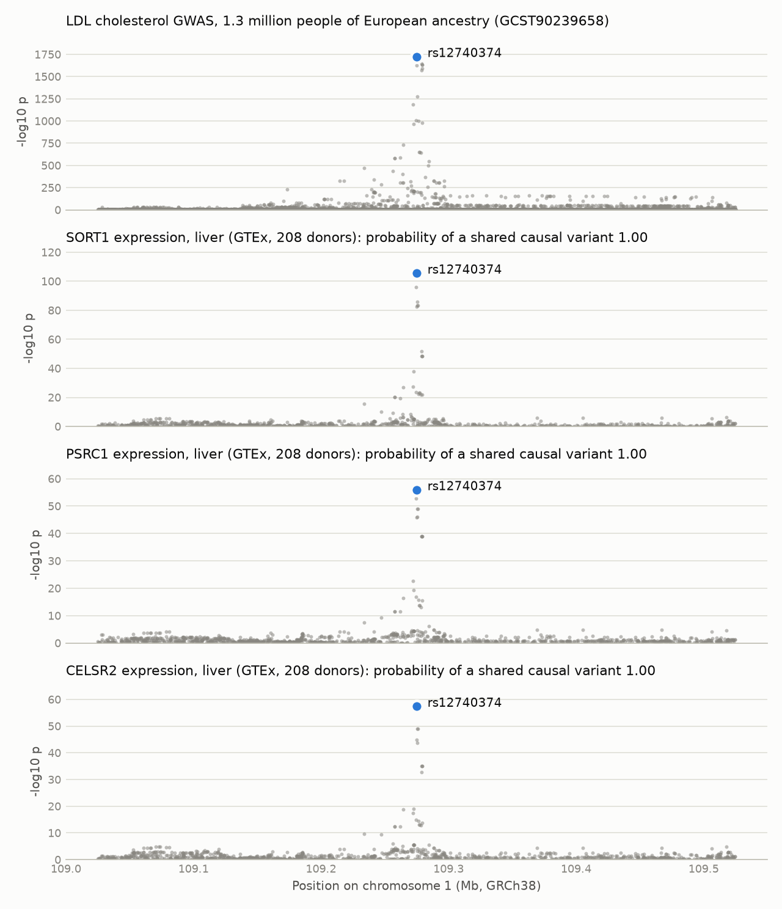

# Fine-mapping and colocalisation from summary statistics

`src/variant2mechanism/statgen` answers two questions about a window of the genome, from published association
statistics alone. No language model is called anywhere in it.

- **Fine-mapping.** Which variants could be the causal one for a trait?
- **Colocalisation.** Do a trait and a gene's expression share a causal variant in the window?

The chain table already reads Open Targets' own credible sets and colocalisations for a variant
(`docs/chain-table.md`). This module computes the same kind of evidence from the public files, with every setting
in view, so the numbers can be reproduced, checked and extended to study pairs nobody has computed.

## The methods

| File | What it computes | What it needs |
|---|---|---|
| `abf.py` | Wakefield's approximate Bayes factor for each variant; from it, each variant's posterior probability of being the causal one, and the 95% credible set | effect and standard error per variant |
| `coloc.py` | the posterior probability of five cases (H0 to H4) for two traits; each variant's share of the shared case | the two traits' Bayes factors over the same variants |
| `susie.py` | the sum of single effects model: a posterior inclusion probability per variant and one credible set per signal | z-scores, and the variants' correlation in the same sample |
| `simulate.py` | a locus in LD with chosen causal variants, and its summary statistics | nothing |
| `sumstats.py` | one window of a GWAS Catalog harmonised file or an eQTL Catalogue dataset, read by tabix over HTTPS and cached; alleles matched | the study's accession |
| `locus.py`, `plot.py` | the analysis of one window, as JSON, and its figure | the two tables |

**The Bayes factor.** For a variant with effect estimate b and standard error s, and a prior N(0, W) on the true
effect, ABF = sqrt(V / (V + W)) · exp(z² / 2 · W / (V + W)), with V = s² and z = b / s. The prior standard deviation
is the coloc package's: 0.15 standard deviations of a quantitative trait, 0.2 for log odds. All arithmetic is on the
log scale, because a z-score of 89 has a p-value near 10⁻¹⁷²⁶.

**Colocalisation.** With at most one causal variant per trait in the window, either neither trait has one (H0),
only the first (H1), only the second (H2), both and they differ (H3), or both and it is the same variant (H4).
Each variant has prior probability p1 of being causal for the first trait alone, p2 for the second alone and p12
for both (1e-4, 1e-4 and 1e-5, coloc's defaults). The posterior of each case follows from sums of the two traits'
Bayes factors; the formulas are in `coloc.py`.

**Several signals.** SuSiE writes the effects as a sum of single effects and fits them from z-scores and the LD
matrix. `susie.py` follows susieR's `susie_rss` with a sample size given, and its defaults.

## What each method assumes

- **`abf.py` and `coloc.py` use no LD.** In its place they assume one causal variant per trait in the window. With
  two signals for one trait, the result follows the stronger one.
- **`susie.py` needs LD from the sample the z-scores come from.** A reference panel only approximates it, and in a
  large GWAS a small mismatch creates signals that are not there. The module therefore runs SuSiE only on
  simulated data, where the LD comes from the same genotypes. For published data, read the credible sets the
  source computed in-sample (Open Targets, the eQTL Catalogue) instead of recomputing them.
- **Both studies must share an LD pattern**, so they should be of the same ancestry.
- **Colocalisation is not mediation.** A high PP.H4 says one variant explains both signals. It does not say the
  trait is caused through that gene.

## Worked example: rs12740374, LDL cholesterol and liver expression

```bash
python scripts/statgen_locus.py --gwas GCST90239658 --eqtl QTS000015/QTD000266 --chrom 1 --pos 109274968 \
    --window 250000 --genes SORT1 PSRC1 CELSR2 --focus-name rs12740374 --out runs/statgen_sort1_<date>
```

The GWAS is the 2021 lipids meta-analysis for LDL cholesterol in 1.3 million people of European ancestry
(GCST90239658); the eQTL dataset is GTEx liver in the eQTL Catalogue (QTD000266, 208 donors). The window is
250 kb either side of the variant. The first run makes six requests to EBI: each file's index (1.8 MB and 2.1 MB),
its first block for the column names, and the window. They are kept in `cache/statgen`, and `--offline` repeats the
analysis with no request.



The window holds 7,491 GWAS variants and 41 genes; 1,281 variants are in both tables for most genes.

| Gene | PP.H3 (two different variants) | PP.H4 (one shared variant) | rs12740374, allele T: GWAS z | Expression z |
|---|---|---|---|---|
| SORT1 | 0.000 | 1.000 | -89.1 | +21.9 |
| PSRC1 | 0.000 | 1.000 | -89.1 | +15.9 |
| CELSR2 | 0.000 | 1.000 | -89.1 | +16.1 |
| STRIP1 | 0.071 | 0.350 | -89.1 | -2.7 |
| ATXN7L2 | 1.000 | 0.000 | -89.1 | +4.1 |
| SYPL2 | 1.000 | 0.000 | -89.1 | +5.4 |

What the result says, and what it does not:

- **Three genes colocalise, not one.** The LDL signal shares its causal variant with the liver expression of
  SORT1, PSRC1 and CELSR2 alike, and rs12740374 carries the whole shared signal for each. Open Targets reports the
  same three for an LDL signal at this variant. Colocalisation cannot choose among them. In the chain table that choice rests on the functional
  steps: which element the variant sits in, which TF's binding it changes, and which gene responds when the
  element is perturbed.
- **Direction.** The T allele lowers LDL cholesterol and raises the liver expression of all three genes.
- **ATXN7L2 and SYPL2 have their own expression signals.** Both have a liver eQTL in the window, but its causal
  variant is a different one (PP.H3 of 1.000).
- **The prior matters little here.** With p12 cut a thousandfold to 1e-8, PP.H4 stays at 1.000 for SORT1, 0.998
  for PSRC1 and 0.843 for CELSR2.
- **The credible set is not to be believed as it stands.** Under one causal variant, the GWAS gives rs12740374 a
  posterior probability of 1.000. Four variants have almost the same effect and allele frequency, as variants in
  near-perfect LD do, and z-scores of -89.08, -88.94, 88.94 and 88.88. In 1.3 million people the formula turns
  gaps of 0.1 to 0.2 into certainty. Gaps that small can come from the sample sizes alone (1,231,254 against
  1,231,006 people: a meta-analysis does not measure every variant in the same people). Read it as "one of these
  four", which is the kind of answer in-sample fine-mapping with LD gives.

## What the tests show on a simulated locus

`tests/statgen` runs every method on loci whose causal variants were chosen, so each is checked against the truth.

| Simulated | Expected, and asserted |
|---|---|
| the two traits share a causal variant | PP.H4 above 0.8; the variant with the largest share is at or beside the causal one |
| each trait has its own, far apart | PP.H3 above 0.8 |
| only one trait has a causal variant | PP.H1 or PP.H2 above 0.8 |
| neither has one | PP.H0 above 0.8 |
| one trait, two causal variants | SuSiE gives two credible sets, each holding its causal variant; the single-variant credible set holds only the stronger |
| two variants in perfect LD | SuSiE's set holds both, with equal probability |
| a GWAS row written for the other allele | its effect changes sign when matched to the eQTL table |

The formulas are also checked directly: the Bayes factor against Wakefield's expression, and the five posteriors
against a sum over every configuration of six variants.

## R

Nothing here needs R. `rcheck.py` runs the same numbers through the `coloc` and `susieR` packages where both are
installed, and its two tests compare the results; they are skipped where the packages are missing. That comparison
has not been run on this machine: R is installed without either package.

## Limits

- One window, one GWAS and one eQTL dataset at a time, named by the caller. Nothing chooses a study for a trait.
- Quantitative traits use a standard deviation estimated from the standard errors, allele frequencies and sample
  sizes, as coloc does. Case-control effects must be log odds ratios.
- A variant listed twice in either table, or with different alleles in the two, is left out.
- The module is not yet a source of the chain table. Its numbers are the same kind of evidence as the Open Targets
  lookups the table already counts, so wiring it in would add coverage, not a new kind of support.
